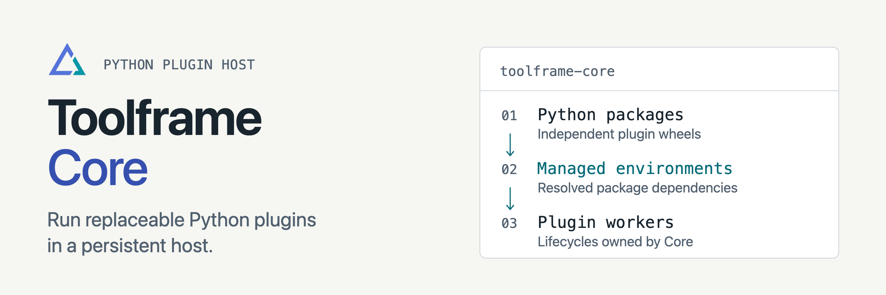

<p align="center">
<picture>
  <source media="(prefers-color-scheme: dark)" srcset="docs/assets/readme-banner-dark.png">
  <source media="(prefers-color-scheme: light)" srcset="docs/assets/readme-banner-light.png">
  
</picture>
</p>

# Toolframe Core

[](https://github.com/toolframe/toolframe-core/actions/workflows/ci.yml?query=branch%3Amain)
[](https://github.com/toolframe/toolframe-core/actions/workflows/container-security.yml?query=branch%3Amain)

Build local apps from Python plugins, with web pages, dashboards and MCP tools.
Update plugins while keeping their data.

## Quick start

With [uv](https://docs.astral.sh/uv/getting-started/installation/) installed,
start the Entry Register demo:

```sh
uv tool install toolframe
toolframe --home ./my-app init \
  --template entry-register
toolframe --home ./my-app serve
```

In another terminal, get the sign-in link:

```sh
toolframe --home ./my-app open
```

The demo includes a Streamlit Dashboard, MCP tools and SQLite storage. It listens
on `127.0.0.1:9876`; keep `my-app` to retain its configuration and data.
After stopping it, restart from `my-app` with `toolframe` or `toolframe serve`.
Without a persistent CLI installation, use `uvx toolframe` from the same directory.
See [application home and restart](docs/operations.md#application-home-and-restart)
for other locations and startup diagnostics.

**Requirements:** macOS 12+ or Linux glibc 2.28+, on ARM64 or x86-64.
First run downloads Python and packages. Windows and musl Linux are unsupported.
See [runtime setup](docs/runtime.md) for offline use and other installation details.

**Access:** Dashboard business access and MCP start public; llms documents remain
public. Configure [authentication](docs/authentication.md) before sharing over a
network. Plugins run trusted Python code; process isolation is not a sandbox.

## Build a plugin

Open an agent in `my-app` and invoke `$toolframe-plugin-design` with your app idea.
`init` installs this skill in `my-app/.agents/skills/`.

For manual development, follow [plugin authoring](docs/authoring.md), or start with
an HTML Notes app in the [Web guide](docs/web.md). Storage, authentication and
presentation are separate plugins you choose for your application.

## Guides

| I want to… | Start here |
| --- | --- |
| Choose a recipe or control versions | [Application recipes](docs/application-templates.md) |
| Install, update or reload plugins | [Operator guide](docs/operations.md) |
| Choose where data lives | [SQL](docs/sql-storage.md) · [Files](docs/object-storage.md) |
| Set up access | [Dashboard](docs/authentication.md) · [MCP](docs/mcp-authentication.md) · [OIDC](docs/oidc-authentication.md) |
| Deploy an application | [Docker](docs/container.md) · [PostgreSQL Core state](docs/postgresql-state.md) |
| Understand how Core works | [Architecture](docs/architecture.md) · [Glossary](docs/glossary.md) |
| Contribute or run checks | [Contributing](CONTRIBUTING.md) · [Testing](docs/testing.md) · [CI](docs/ci.md) |

[Changelog](CHANGELOG.md) · [Releases](https://github.com/toolframe/toolframe-core/releases)

## License

Core and the launcher: [Apache 2.0](LICENSE), with [NOTICE](NOTICE).
The bundled [agent guide](src/toolframe_core/bundled_skills/toolframe-plugin-design/LICENSE)
and [basic template](src/toolframe_core/basic_template/LICENSE): MIT.
